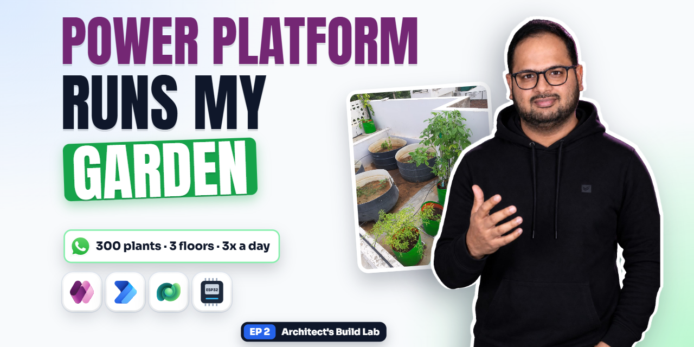
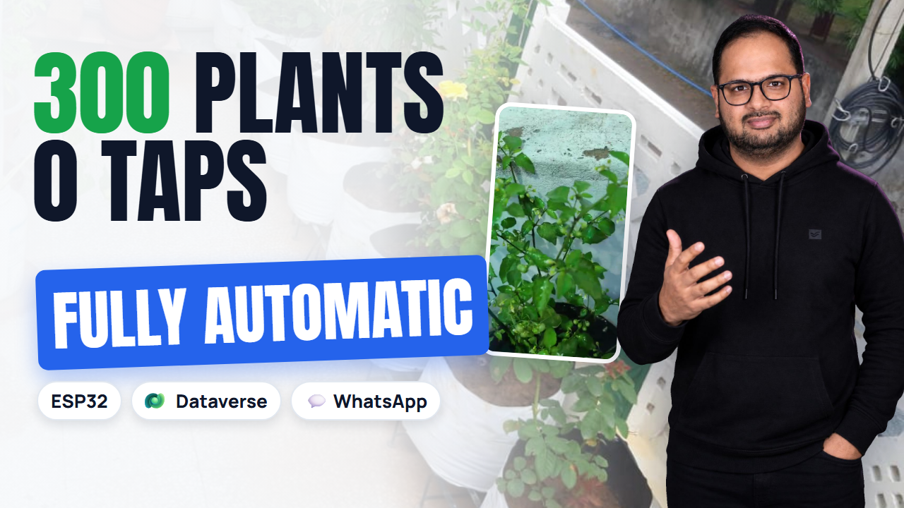
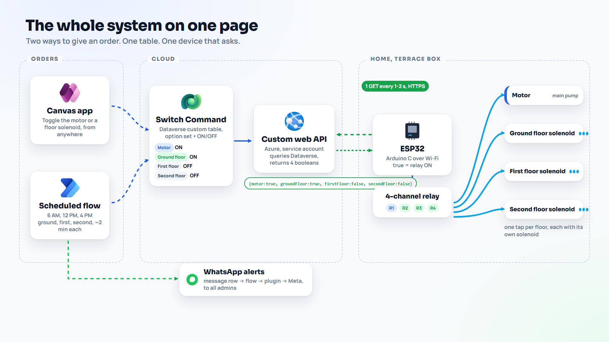
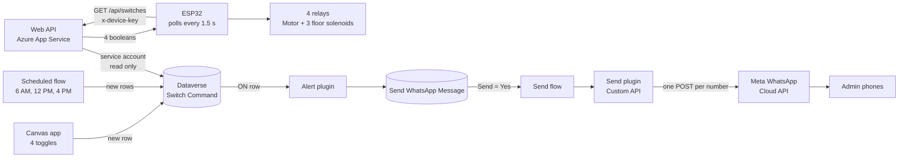
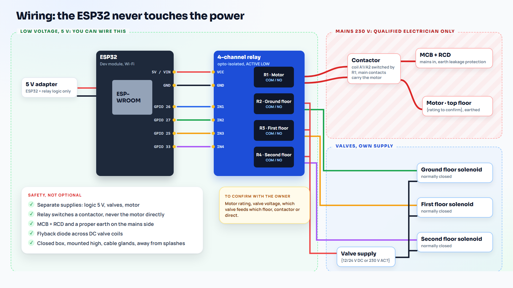

<p align="center">
  
</p>

# build-lab-ep02-smart-plant-watering

**Architect's Build Lab, Episode 2: smart plant watering with an ESP32, Dataverse and WhatsApp alerts**

> My phone waters more than 300 plants on three floors, three times a day, and nobody at home touches a tap. This is the full build: the board, the cloud and the alerts.

[](LICENSE)
[](https://learn.microsoft.com/power-platform/)
[](https://learn.microsoft.com/power-apps/maker/data-platform/)
[](https://learn.microsoft.com/power-automate/)
[](https://learn.microsoft.com/azure/app-service/)
[](docs/wiring.md)
[](arduino/CallAPI/CallAPI.ino)
[](https://developers.facebook.com/docs/whatsapp/cloud-api/)
[](plugins/SmartWatering.Plugins/SmartWatering.Plugins.csproj)

## What this is and why

Watering plants on three floors by hand, every day, is easy to forget and hard to do while you are away.
This repo is the system that does it at home: a phone app and a schedule give the orders, an ESP32 on the terrace switches the pump and one tap per floor, and every admin gets a WhatsApp message when watering starts.
It runs at our home every day, and this repo is the full working build, set up step by step in a demo environment so you can build it too.

## Watch the video

**[Watch the full build on YouTube](https://youtu.be/1v5VGksp0go)** (34 minutes, chapters in the description). More episodes: [youtube.com/@arihant.explains](https://www.youtube.com/@arihant.explains).

<a href="https://youtu.be/1v5VGksp0go"></a>

## What it achieves

At 6 AM the schedule runs, or you tap **Ground floor** and then **Motor** in the app:

1. a new row lands in the Dataverse **Switch Command** table,
2. within about 1.5 seconds the ESP32 asks the web API and gets one answer, `{"motor":true,"groundFloor":true,"firstFloor":false,"secondFloor":false}`,
3. the ground floor tap opens, and 2 seconds later the motor starts (never the other way round),
4. a plugin adds a **Send WhatsApp Message** row, "Watering Ground floor", and a flow and a second plugin send it to every admin number through the Meta WhatsApp Cloud API,
5. after 2 minutes the schedule opens the first floor tap, closes the ground floor one, and so on up to the second floor,
6. if anything goes wrong (Wi-Fi down, API down, a forgotten toggle), the board turns everything off on its own.



## Architecture



Dataverse is the single source of truth: every order is a new row and the newest row per switch wins. The web API turns those rows into one small answer, so the board needs no Dataverse credentials and no OData. The ESP32 only drives relays and keeps its own safety rules. Messages are data too: a row, a flow, a plugin, then Meta. The full walkthrough, with the WhatsApp sequence and the ESP32 loop, is in [docs/ARCHITECTURE.md](docs/ARCHITECTURE.md).

## How it works

**The web API (one call instead of four).** The ESP32 never talks to Dataverse. Every 1.5 seconds it calls `GET /api/switches` with its device key. The API signs in to Dataverse with a read-only service account, keeps the token until just before it expires, reads the newest Switch Command row for each switch in one query, and answers with four true or false values. A missing switch counts as false. If Dataverse is down the API answers with an error, and the board counts a failed poll. Code: [webapi/server.mjs](webapi/server.mjs).

**The plugins (messages are data too).** When an ON row lands in Switch Command, `SwitchCommandNotifyPlugin` adds a row to Send WhatsApp Message. When that row is set to Send = Yes, a flow calls the `SendWhatsAppMessagePlugin` Custom API, which reads the admin numbers from an environment variable, checks each one, sends one request per number to the Meta WhatsApp Cloud API and writes the result back on the row. `GetSwitchStatesPlugin` is the optional Custom API version of the newest-row-per-switch read. Code: [plugins/](plugins/), with 41 unit tests.

**The schedule and the app write rows, nothing else.** The canvas app adds one row per toggle. The scheduled flow at 6 AM, 12 PM and 4 PM adds rows floor by floor, opening the next tap before it closes the previous one. Neither of them ever talks to the hardware.

## The safety rules on the board

The cloud decides what should happen. The board decides what is allowed to happen. All of these live in [arduino/CallAPI/CallAPI.ino](arduino/CallAPI/CallAPI.ino), with the numbers in [config.h](arduino/CallAPI/config.h):

| Rule | What it does |
|---|---|
| All off at boot | Every relay is switched off before Wi-Fi even starts, and active-low boards are handled by one constant. |
| Tap before motor | The motor may only start 2 seconds after a tap is open, and the last tap closes 2 seconds after the motor stops. No tap open, no motor. |
| 10 minute limit | No switch stays on longer than 10 minutes, whatever the app or the flow says. After an auto-off the switch stays latched off until the API reports false once. |
| Fail-safe | 10 failed polls in a row (about 15 seconds without an answer) and everything goes off. Wi-Fi down, internet down or API down, it does not matter which. |
| Real HTTPS | The certificate is checked against a pinned root, every call has a 3 second timeout, and Wi-Fi reconnects on its own. |

## Wiring



| ESP32 pin | Relay | Switches |
|---|---|---|
| GPIO 26 | 1 | Motor (main pump), through a contactor |
| GPIO 27 | 2 | Ground floor solenoid |
| GPIO 25 | 3 | First floor solenoid |
| GPIO 33 | 4 | Second floor solenoid |

Most relay boards are active low (`RELAY_ACTIVE_LOW` in `config.h`). The ESP32 and the valves use separate supplies. Avoid GPIO 12 and 14 for relays: GPIO 12 is a boot strapping pin and GPIO 14 pulses at boot. Mains wiring (the motor, the contactor, RCD and MCB) is for a qualified electrician only. Full details: [docs/wiring.md](docs/wiring.md).

## Run it locally (5 minutes, no cloud)

```bash
cd webapi
npm test                                              # 15 checks
MODE=mock DEVICE_KEY=any-long-test-key-123456 npm start
# play the app: add a row, then ask like the ESP32 does
curl -X POST localhost:8080/api/mock/rows -H "x-device-key: any-long-test-key-123456" \
     -d '{"switch":"groundFloor","on":true,"source":"App"}'
curl localhost:8080/api/switches -H "x-device-key: any-long-test-key-123456"
```

Mock mode is for the bench only, never on the internet. Then test the ESP32 sketch against it (relays only, no water, no mains): copy `arduino/CallAPI/secrets.example.h` to `secrets.h`, fill in your own Wi-Fi, API host and device key, and upload with board **ESP32 Dev Module**. More in [webapi/README.md](webapi/README.md) and [arduino/README.md](arduino/README.md).

## What's in the box

| Part | What it does |
|---|---|
| ESP32 sketch | One HTTPS call per poll, certificate check, device key, four relays, fail-safe, 10 minute limit, tap-before-motor interlock |
| Web API | Node 18+, no packages. Mock mode for the bench, Dataverse mode with a service account, optional Custom API read. 15 automated checks. |
| Dataverse | Switch Command and Send WhatsApp Message tables, six environment variables, two Custom APIs, a schema script |
| Plugins (C#) | `SwitchCommandNotifyPlugin` (ON row -> message row), `GetSwitchStatesPlugin` (four booleans), `SendWhatsAppMessagePlugin` (Meta Cloud API, every admin number). 41 unit tests. |
| Flows | Scheduled watering with hand-over and an error scope; send WhatsApp message |
| Canvas app | Four toggles, formulas included |

## Folder map

```text
.
├── arduino/CallAPI/        ESP32 sketch: CallAPI.ino, config.h, secrets.example.h
├── webapi/                 Node web API (server.mjs, test.mjs, .env.sample), App Service steps
├── plugins/                C# Dataverse plugins (net462) + xunit tests (net8.0)
├── dataverse/              schema.json, create-schema.mjs, manual maker portal steps
├── flows/                  the two Power Automate flows, step by step
├── app/                    the canvas app and its formulas
├── docs/                   architecture, setup, permissions, placeholders, security, wiring
├── SECURITY.md  CONTRIBUTING.md  CHANGELOG.md  LICENSE
└── .github/ISSUE_TEMPLATE/ bug report and setup question forms
```

## Prerequisites

- A **demo or developer environment** for Power Platform. Build it there first, never straight in production.
- An Azure subscription for App Service (Key Vault recommended for secrets).
- A Meta developer app with WhatsApp, a business phone number and its phone number ID, and an approved message template for real alerts.
- Node.js 18 or newer, any recent .NET SDK (the .NET Framework reference assemblies come from NuGet), the Power Platform CLI (`pac`), the Arduino IDE 2 with the esp32 core 3.x and ArduinoJson 7.x.
- An ESP32 dev board and a 4-channel opto-isolated relay module. For the real install: a contactor for the motor, normally closed solenoids, RCD and MCB, and **a qualified electrician** for anything on mains.

## Setup in a demo environment

Build bottom-up and test each layer before the next. Every step is spelled out in [docs/setup.md](docs/setup.md).

1. **Dataverse.** Publisher prefix `cr`, the two tables, the choice values `100000000` to `100000003`, six environment variables: [dataverse/README.md](dataverse/README.md).
2. **Web API, mock mode.** `cd webapi && npm test`, then run it locally.
3. **ESP32 on the bench.** Relays only, no mains: [arduino/README.md](arduino/README.md).
4. **Web API on Azure.** App registration, application user with a read-only role, App Service settings: [webapi/README.md](webapi/README.md).
5. **Canvas app.** Four toggles that add rows: [app/README.md](app/README.md).
6. **Plugins.** Build, test, sign and register:

   ```bash
   git clone https://github.com/arihantexplains/build-lab-ep02-smart-plant-watering.git
   cd build-lab-ep02-smart-plant-watering/plugins/SmartWatering.Plugins
   sn -k key.snk          # once; git-ignored, keep it private
   dotnet build -c Release
   cd ../SmartWatering.Plugins.Tests && dotnet test -c Release
   ```

   Register `bin/Release/net462/SmartWatering.Plugins.dll`, the step for the alert plugin, and the plugin types on the two Custom APIs: [plugins/README.md](plugins/README.md).
7. **WhatsApp.** Phone number ID, token in Key Vault, admin numbers, template, and the send flow: [flows/send-whatsapp-message.md](flows/send-whatsapp-message.md).
8. **Schedule.** [flows/scheduled-watering.md](flows/scheduled-watering.md), with your time zone set on the trigger.
9. **Real install.** Electrician, then one full run with water while you watch: [docs/wiring.md](docs/wiring.md).

Who may do what, and what was left out on purpose: [docs/permissions.md](docs/permissions.md).

## Placeholders

Everything you fill in (Wi-Fi, API host, device key, root certificate, tenant and client IDs, secret, environment URL, table and column names, publisher prefix, environment variables, WhatsApp phone number ID, token, template, admin numbers) is in **one table**: [docs/PLACEHOLDERS.md](docs/PLACEHOLDERS.md). The repo itself contains placeholders only.

## Security model

| Layer | Guardrail |
|---|---|
| Device to API | HTTPS with the certificate checked against a pinned root, plus an `x-device-key` header compared in constant time |
| API to Dataverse | App registration with a read-only role on one table; secret in App Service settings or Key Vault |
| Device credentials | `secrets.h` is git-ignored; the board never holds Dataverse credentials |
| Pump and taps | All OFF at boot, motor only with an open tap, tap first and motor last, 10 minute limit, everything OFF after 10 failed polls |
| WhatsApp | Alert rows created by the plugin as SYSTEM, numbers validated and masked, token in a Secret environment variable, no repeat sends |
| Mains | Contactor, RCD, MCB, separate supplies, electrician |

Known limits, stated plainly (shared device key, flash not encrypted, "sent" means accepted by Meta, who can message whom): [docs/security.md](docs/security.md). To report a problem, see [SECURITY.md](SECURITY.md).

## Troubleshooting

| You see | Likely cause and fix |
|---|---|
| `[WIFI] not connected yet, will keep trying` | Wrong `WIFI_SSID` or `WIFI_PASSWORD`, or a 5 GHz network. The ESP32 needs 2.4 GHz. |
| `[POLL] failed, 401` | The board's `DEVICE_KEY` does not match the API's `DEVICE_KEY` app setting. |
| `[POLL] failed, connection refused` | Wrong `API_HOST`, the API is stopped, or the certificate check failed. Check `ROOT_CA` against the top of your API's certificate chain. |
| `[POLL] failed, 502` | The API cannot read Dataverse. Look in the App Service log stream for `token 401` (wrong tenant, client ID or secret) or `dataverse 403` (application user missing or no read role). |
| `[SAFETY] 10 polls failed, everything OFF` | The board lost the API for about 15 seconds and switched everything off on purpose. It follows the app again with `[SAFETY] API reachable again, following the app`. |
| `[SAFETY] Motor stopped, no solenoid is open` | The motor was asked to run with every tap closed. Open a tap first; the motor starts 2 seconds later. |
| `[SAFETY] Motor auto-off after 10 min` | The 10 minute limit. Turn the switch OFF in the app, then ON again. In the schedule, keep the motor's total run under 10 minutes. |
| `DEVICE_KEY is missing or too short (24 characters or more). Refusing to start in dataverse mode.` | Set a long random `DEVICE_KEY` in the App Service settings. |
| No "Motor started" row after an ON row | The `SwitchCommandNotifyPlugin` step is not registered, or it is not Create / PostOperation on `cr_switchcommand`. Check System Jobs for a failed async job. |
| `Environment variable cr_WhatsAppPhoneNumberId has no value in this environment.` | Give the environment variable a current value (or a default). The same message names any other missing variable. |
| `No valid recipient numbers. Check the cr_WhatsAppAdminNumbers environment variable.` | The list is empty or every number was refused. Use digits with the country code: `91XXXXXXXXXX,91XXXXXXXXXX`. |
| A Result line `... is too short, include the country code (for example 91 for India), skipped` | A 10 digit number without the country code. Add it. |
| `failed, Meta returned 401, code 190: ...` | The access token expired or is wrong. The temporary token from API Setup lasts 24 hours; use a system user token. |
| `failed, Meta returned 400, code 132001: ...` | The template name or language does not match an approved template. |
| Delivery status Sent but no message, or code `131047` | Plain text outside the 24 hour window. Set `cr_WhatsAppTemplateName` to an approved template. |
| `WhatsApp settings are not valid: The WhatsApp phone number ID must be digits only.` | You pasted the phone number or a placeholder instead of the phone number ID. |
| The flow runs again and again | The trigger is missing Select columns `cr_send` or Filter rows `cr_send eq true`. |
| Plugin registration fails with a strong-name error | Run `sn -k key.snk` in `plugins/SmartWatering.Plugins` and rebuild, so the assembly is signed. |

## FAQ

**Why not let the ESP32 call Dataverse directly?** It would need a client secret on a board on the terrace, OAuth tokens, OData queries and JSON parsing in C, and a re-flash for every table change. One small API keeps all of that on the server and gives the board one answer.

**Why does the board poll instead of the cloud pushing?** Polling needs no open port into the home network and no extra service. One small request every 1.5 seconds is cheap, and it doubles as a heartbeat: when polls fail, the board knows to switch everything off.

**Why a plugin for WhatsApp and not an HTTP action in the flow?** The plugin keeps the number checks, the template logic and the Meta call in one tested place, reads the token from a Secret environment variable, and writes a clear result back to the row. Any flow or app sends a message just by adding a row.

**Can I use this in production?** It is a teaching sample. The patterns are the ones I use in real projects, but test it properly and have it reviewed before you trust it with a real pump, and let an electrician do the mains side.

**Does it need premium Power Platform licences?** Dataverse, the Dataverse connector in flows and canvas apps on Dataverse need the right Power Apps or Power Automate licences. A developer environment is free for building and testing.

**Does WhatsApp cost money?** Meta charges per message for some conversation types, and business-initiated template messages are charged in most countries. Check Meta's current pricing for your country.

**Can I add a fourth floor or a second pump?** Yes: a new choice value, a new key in the API answer, a new entry in the sketch's switch table, a new pin in `config.h`, and a new alert text in `Switches.cs`.

## More from Architect's Build Lab

- Episode 1, an AI agent for user onboarding with a Dataverse plugin built from scratch: [build-lab-ep01-it-onboarding-agent](https://github.com/arihantexplains/build-lab-ep01-it-onboarding-agent) and [the video](https://youtu.be/ipQJsIAqqNM)
- The whole series on YouTube: [Architect's Build Lab playlist](https://www.youtube.com/playlist?list=PLAts8F4bMzpY)
- New to Power Apps, Dataverse or Power Automate? Start with the free [Power Platform Fundamentals course](https://www.youtube.com/playlist?list=PLZDG2cQXK0IM)

## Credits

Built and explained by **Arihant Jain** ([Arihant Explains](https://www.youtube.com/@arihant.explains)), a Solution Architect with nearly 15 years of experience building business apps, automation and AI solutions on Power Platform, Copilot Studio, Dataverse and Azure.

Contributions are welcome, see [CONTRIBUTING.md](CONTRIBUTING.md). Changes are listed in [CHANGELOG.md](CHANGELOG.md).

## License

[MIT](LICENSE). Use it, change it, learn from it.

Microsoft, Power Apps, Power Automate, Dataverse and Azure are trademarks of the Microsoft group of companies. WhatsApp and Meta are trademarks of Meta Platforms, Inc. ESP32 is a trademark of Espressif Systems. Arduino is a trademark of Arduino SA.
