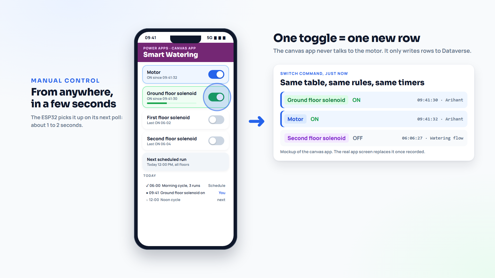

# Canvas app: Smart Watering

A one-screen Power Apps canvas app with four toggles: Motor, Ground floor solenoid, First floor solenoid, Second floor solenoid. **One toggle = one new Switch Command row.** The app never talks to the motor or the ESP32; it only writes rows, and the board picks the change up on its next poll, about 1 to 2 seconds later.



The picture is a mockup from the video. Your app can look however you like; only the rows it writes matter.

## Build it

1. make.powerapps.com > your solution > New > App > Canvas app, Phone layout. Name: `Smart Watering`.
2. Data > Add data > **Switch Commands**.
3. Add four **Toggle** controls, one per switch, with a label next to each.

For the Motor toggle (repeat with the matching choice for the other three):

**OnCheck**

```powerfx
Patch(
    'Switch Commands',
    Defaults('Switch Commands'),
    {
        Name: "Motor ON",
        Switch: 'Switch (Switch Commands)'.Motor,
        Status: true,
        Source: "App"
    }
)
```

**OnUncheck**: the same with `Name: "Motor OFF"` and `Status: false`.

**Default** (shows the current state when the app opens):

```powerfx
With(
    { latest: First(Sort(Filter('Switch Commands', Switch = 'Switch (Switch Commands)'.Motor), 'Created On', SortOrder.Descending)) },
    !IsBlank(latest) && latest.Status
)
```

The exact name of the choice (`'Switch (Switch Commands)'.Motor`) depends on your table and column names; type `'Switch (` and IntelliSense shows the right one. If `Status` shows as ON/OFF labels instead of true/false in your environment, compare with the label the same way.

## Notes

- **Turn on the tap before the motor.** If you switch the motor on with every tap closed, the board refuses and logs `[SAFETY] Motor stopped, no solenoid is open`. The motor starts by itself 2 seconds after a tap opens.
- **Who may use the app.** Share it only with the people who may water the garden, and give them a role with create and read on Switch Command. They need no rights on the Send WhatsApp Message table: the alert plugin creates those rows as SYSTEM.
- **Delegation.** The `Default` formula sorts and filters on the server for Dataverse, so it stays fast as the table grows. Clean up old rows now and then with a bulk delete job if you like; the system only ever needs the newest row per switch.
