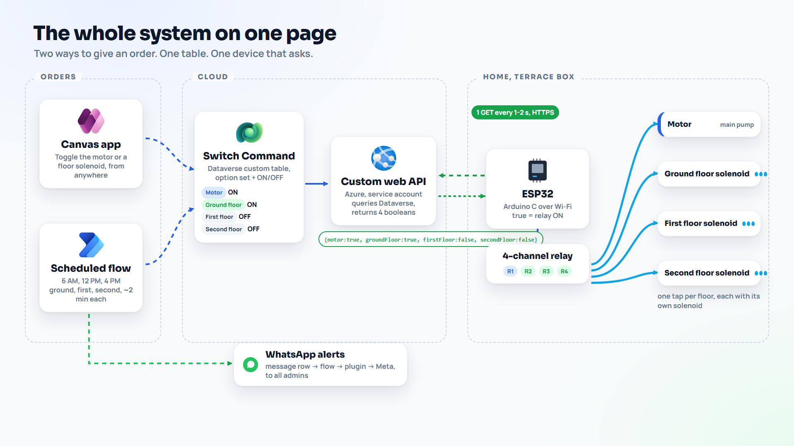
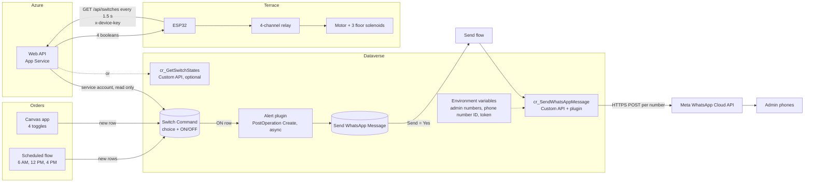
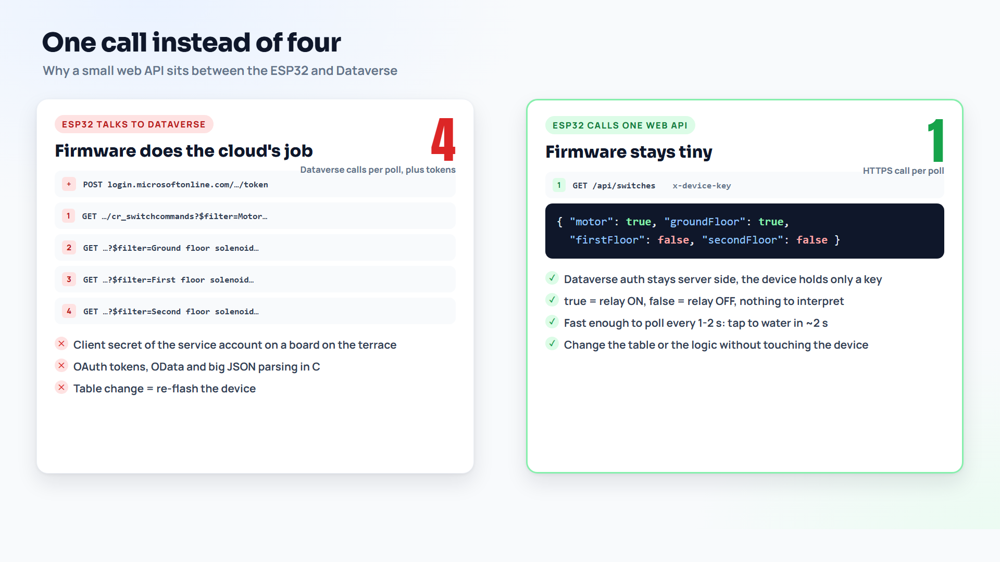
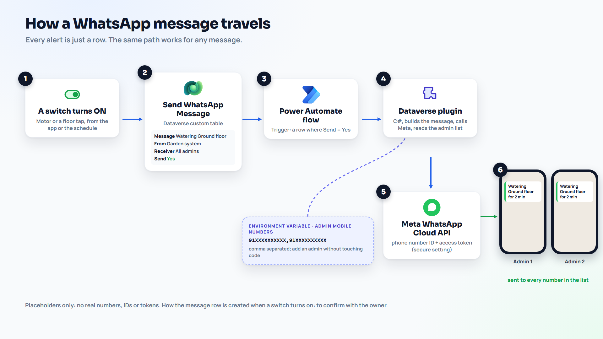
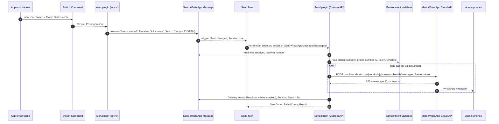
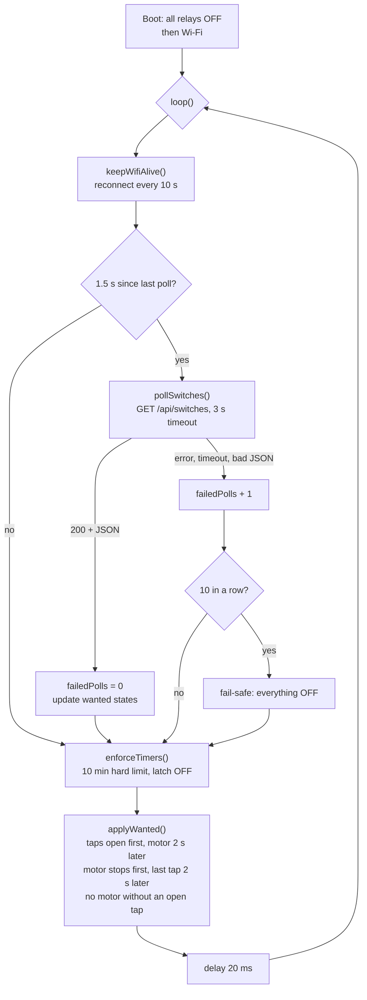

# Architecture

The whole system on one page: two ways to give an order, one table, one device that asks.

## The pieces

| Piece | Where it runs | Job | Code or steps |
|---|---|---|---|
| Canvas app | Power Apps, on any phone | Four toggles. One toggle = one new Switch Command row. | [app/README.md](../app/README.md) |
| Scheduled flow | Power Automate | 6 AM, 12 PM, 4 PM: ground, first, second floor, about 2 minutes each, motor on, with a hand-over between taps. Writes rows, like the app. | [flows/scheduled-watering.md](../flows/scheduled-watering.md) |
| Switch Command table | Dataverse | The single source of truth. Every order is a row; the newest row per switch wins. | [dataverse/](../dataverse/README.md) |
| Web API | Azure App Service (Node) | Signs in to Dataverse with a read-only service account, answers the device with ONE JSON of four booleans, checks the device key. | [webapi/](../webapi/README.md) |
| ESP32 | A closed box on the terrace | Polls every 1.5 s, drives four relays, enforces the safety rules. | [arduino/](../arduino/README.md) |
| Alert plugin | Dataverse (async) | A switch turned ON adds a Send WhatsApp Message row. | [plugins/](../plugins/README.md) |
| Send WhatsApp Message table | Dataverse | One row per message, with its result. | [dataverse/](../dataverse/README.md) |
| Send flow | Power Automate | Send = Yes calls the `cr_SendWhatsAppMessage` Custom API. | [flows/send-whatsapp-message.md](../flows/send-whatsapp-message.md) |
| Send plugin | Dataverse (Custom API) | Reads the admin numbers and Meta settings from environment variables and calls the Meta WhatsApp Cloud API once per number. | [plugins/](../plugins/README.md) |

## System diagram

## Why one call instead of four

The 2023 version asked the cloud once per switch, plus extra calls for notifications. Now the board makes one HTTPS call and gets four booleans. Dataverse sign-in, OData and the "newest row per switch" rule stay on the server. You can change the table, the logic or the alert rules without touching the device. More in [before-after.md](before-after.md).

The web API can work out the answer in two ways (`DATAVERSE_READ`):

- **`table`**: it queries the newest 50 Switch Command rows itself.
- **`customapi`**: it calls `cr_GetSwitchStates`, and the C# plugin does the same query inside Dataverse.

Both return the same JSON, and both read as OFF for a switch that has no row (or whose newest row is older than the newest 50 rows), which is the safe side.

## How a WhatsApp message travels

Any message works the same way. To tell the admins "Fertiliser day on Sunday", add a row with that text and Send = Yes. To message one person, fill in Receiver number.

## Inside the ESP32 loop

## Design choices

- **Rows, not updates.** Every order is a new row. You get a full history for free, the app and the flow never fight over the same record, and "newest row wins" is easy to reason about.
- **A choice column for the switch.** Four fixed values, `100000000` to `100000003`. No typos, and labels can change without breaking the device mapping.
- **The device holds no cloud credentials.** It has a device key for one read-only endpoint. The Dataverse secret lives in App Service settings (ideally Key Vault).
- **Safety on the board, not in the cloud.** Whatever the cloud says, the ESP32 keeps the motor off without an open tap, stops anything after 10 minutes and turns everything off when it loses the API.
- **Alerts are data.** A message is a row with a history and a result, and any app or flow can send one by adding a row. The plugin holds the Meta logic in one tested place.
- **Settings in environment variables.** Admin numbers, phone number ID, token and template can change without a code change, and differ per environment.

## Data stored

| Where | What | Personal data |
|---|---|---|
| Switch Command | Switch, ON/OFF, source, created on/by | Who toggled (Dataverse user) |
| Send WhatsApp Message | Text, from, receiver name and number, status, result | Receiver name and number if you fill them in. Result lines mask numbers. |
| Environment variables | Admin numbers, phone number ID, token | Admin mobile numbers |
| Web API | Nothing stored. Errors go to the App Service log without the key or token. | None |
| ESP32 | Wi-Fi password, device key, root certificate in flash | None |
