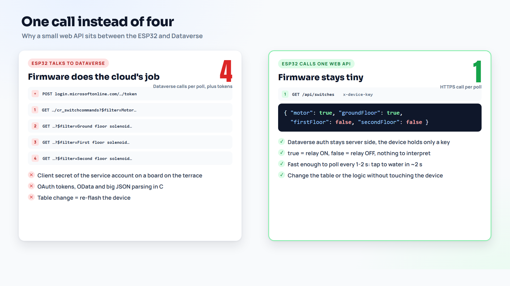

# Before and after: the 2023 sketch vs v2

The first version has watered our plants since 2023. It worked, but it grew one fix at a time. v2 keeps the idea (an app and a schedule write orders to Dataverse, the ESP32 follows) and rebuilds the parts that were fragile or unsafe. The old sketch is not in this repo; this page explains what changed and why.

| Area | 2023 version | v2 (this repo) | Why it matters |
|---|---|---|---|
| Relays | 3 relays, with floors sharing a relay | 4 relays: Motor, Ground, First, Second floor solenoid, one tap per floor | Each floor can be watered on its own, and the hand-over between floors works. |
| Calls per poll | One GET per switch, plus separate notification calls | **One** GET that returns four booleans | Fewer calls, faster, less to go wrong on a weak Wi-Fi link. |
| Where the logic lives | On the board: which rows to read, when to notify | In the cloud: the web API (or the `cr_GetSwitchStates` plugin) works out the states | Change the table or the rules without re-flashing the device. |
| Notifications | Triggered from the device | A Dataverse plugin creates a message row, a flow and a plugin send it through Meta | The board only drives relays. Any app or flow can send a message by adding a row. |
| HTTPS | Plain HTTPS without a certificate check, no device key | Certificate checked against a pinned root, plus an `x-device-key` header | Nobody can pretend to be your API, and the API only answers your board. |
| Credentials | Secrets in the code | `secrets.h` (git-ignored) on the board; Dataverse credentials only on the server | The code can be shared, as it is here. |
| Timers and safety | None: a relay stayed on as long as the cloud said so | All OFF at boot, fail-safe after 10 failed polls, 10 minute hard limit, valve-first interlock (tap opens 2 s before the motor, motor stops 2 s before the last tap) | A lost connection or a forgotten toggle cannot run the pump dry or flood a floor. |
| Pins | GPIO 12 and 14 among the relay pins | GPIO 26, 27, 25, 33 | GPIO 12 is a boot strapping pin and GPIO 14 pulses at boot. The new pins have no boot role. |
| Timeouts | Calls could hang | 3 s per call, Wi-Fi reconnect every 10 s without blocking | The loop keeps running and the safety rules keep working. |
| Settings | Spread through the sketch | `config.h`: pins, timings, API path in one place | Easy to tune and review. |

## What stayed the same

- Dataverse is still the single source of truth, and every toggle is a new row.
- The ESP32 still asks (polls); nothing in the cloud needs to reach into the home network.
- The same two ways to give an order: the canvas app and the scheduled flow.
