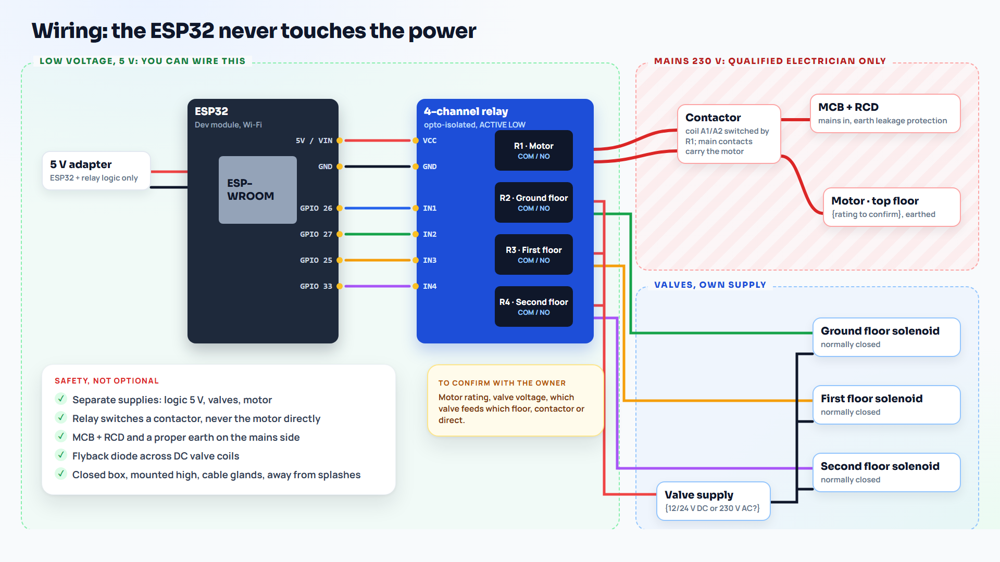

# Wiring and electrical safety

The picture is the plan from the video. Notes on it marked "to confirm" are the parts that depend on your own motor and valves: check them for your install.

> **Mains electricity can kill.** Everything on the 230 V side (motor, contactor, any 230 V solenoids, the RCD and MCB) must be done by a **qualified electrician**, following your local wiring rules. The low voltage side (ESP32, relay inputs, 5 V supply) is the part you can wire yourself.

## Low voltage side (you can wire this)

| ESP32 pin | Relay input | Device |
|---|---|---|
| GPIO 26 | IN1 | Motor (through a contactor, see below) |
| GPIO 27 | IN2 | Ground floor solenoid |
| GPIO 25 | IN3 | First floor solenoid |
| GPIO 33 | IN4 | Second floor solenoid |
| GND | GND | Common ground for the relay inputs |
| 5V / VIN | VCC | Relay board logic supply |

- Use an **opto-isolated** relay module. Most are active LOW (`RELAY_ACTIVE_LOW true` in `config.h`).
- Power the ESP32 and the relay logic from their **own 5 V adapter**. Never take the ESP32's supply from the motor circuit.
- The relay outputs (COM and NO) carry the load side. Use NO (normally open), so a dead board means everything is off.

## Motor (electrician)

- **Do not switch the motor directly with the small relay.** Let relay 1 switch the coil of a **contactor** rated for the motor's running and starting current, and let the contactor's main contacts carry the motor.
- Protect the motor circuit with an **RCD** (earth leakage, typically 30 mA) and a correctly rated **MCB**, and make sure the motor is **earthed**.
- Use a contactor coil voltage that matches what relay 1 switches, and keep the coil circuit on the same protected supply.

## Solenoids (separate supply)

- Give the solenoids their **own supply**, matching their coil voltage (often 12 V or 24 V DC, sometimes 230 V AC; check the label).
- Use **normally closed** solenoids: with no power, no water flows.
- For DC coils switched directly, fit a **flyback diode** across each coil (ready-made relay modules usually protect their own relay coils, not your valve coils).
- 230 V AC solenoids are mains wiring: electrician.

## The box

- ESP32, relay board and adapters in a closed box, mounted high, away from splashes and direct sun.
- Cable glands where cables enter, drip loops on cables below the box.
- Label every wire at both ends.

## Before you leave it running

1. Bench test with the relays only, no mains: run the scheduled flow with short delays and watch the clicks and the Serial Monitor.
2. Electrician connects the motor through the contactor and the solenoids on their supply.
3. Run one full schedule with water while you watch: each floor gets water, the motor never runs with all taps closed, and everything is off at the end.
4. Pull the Wi-Fi plug during a run: within about 15 seconds everything goes OFF.
