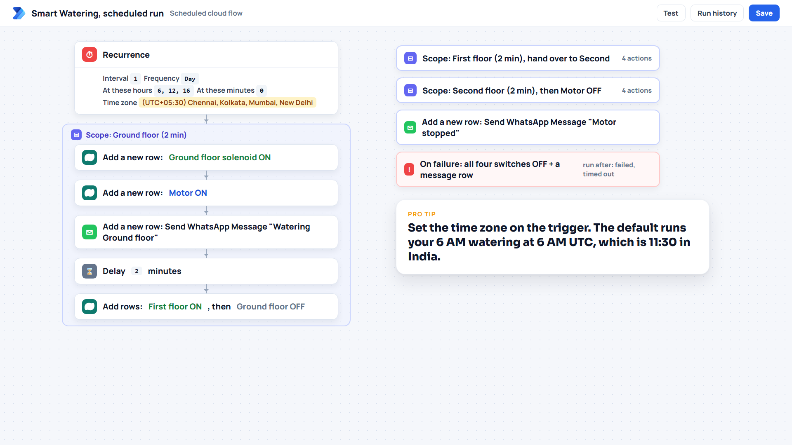

# Power Automate flows

Two cloud flows. Both are described step by step so you can build them in a few minutes; there are no exported flow packages in the repo, because exports carry connection and environment details.

| Flow | Trigger | What it does | Walkthrough |
|---|---|---|---|
| Smart Watering, scheduled run | Recurrence, 6 AM, 12 PM and 4 PM | Ground, then first, then second floor, about 2 minutes each with the motor on, by adding Switch Command rows | [scheduled-watering.md](scheduled-watering.md) |
| Send WhatsApp message | A Send WhatsApp Message row with Send = Yes | Calls the `cr_SendWhatsAppMessage` Custom API, whose plugin sends the message through Meta | [send-whatsapp-message.md](send-whatsapp-message.md) |

The picture from the video also shows "Watering ..." message rows inside the flow. In this repo the ON alerts come from the alert plugin instead, so the flow only adds the optional "done" and "failed" messages. Adding both would send every alert twice.

Neither flow talks to the ESP32. The scheduled flow only writes rows, exactly like the canvas app does, so the board treats a schedule and a tap on the phone the same way and applies the same safety rules.

## Connections

Use a connection that belongs to a dedicated service user (or your own user in a demo environment), not a personal connection of someone who might leave. That user needs:

| Flow | Rights |
|---|---|
| Scheduled run | Create on Switch Command. Create on Send WhatsApp Message only if you keep the optional "done" and "failed" messages. |
| Send WhatsApp message | Read and write on Send WhatsApp Message, read on environment variables (the plugin runs as this user). |
