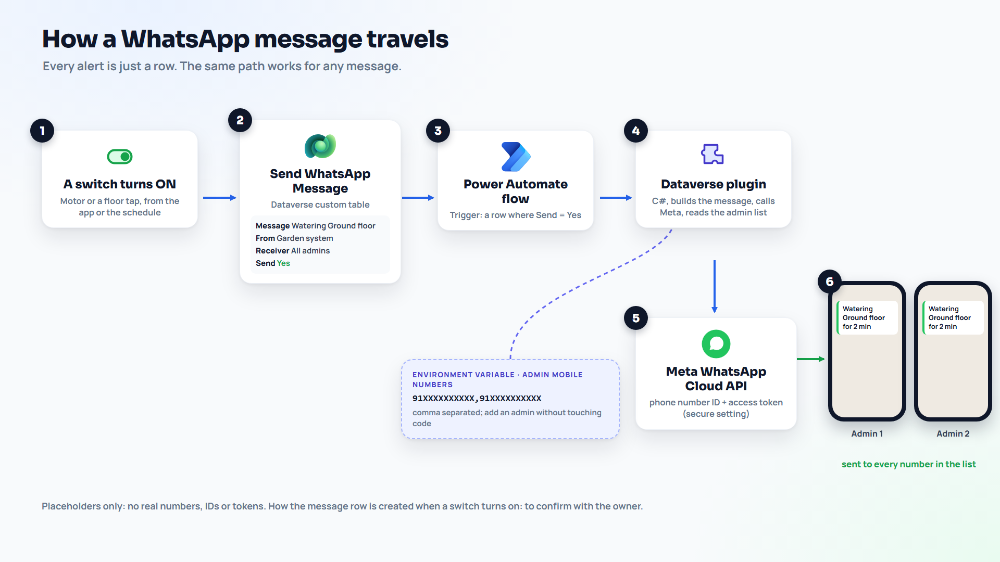

# Flow: Send WhatsApp message

Every WhatsApp message in the system takes the same path: **a new row, then this flow, then the plugin, then Meta, then the phones.** The alert plugin, the scheduled flow, the canvas app or you by hand all just add a Send WhatsApp Message row with Send = Yes.

**Create it:** make.powerapps.com > your solution > New > Automation > Cloud flow > Automated. Name: `Send WhatsApp message`.

## Trigger

Dataverse: **When a row is added, modified or deleted**

| Setting | Value | Why |
|---|---|---|
| Change type | Added or Modified | New rows, and drafts that are switched to Send = Yes later. |
| Table name | Send WhatsApp Messages | |
| Scope | Organization | Rows created by anyone, including the plugin (SYSTEM). |
| Select columns | `cr_send` | Fires only when Send changes, not when the plugin writes the result. |
| Filter rows | `cr_send eq true` | Only rows that should be sent. |

The plugin sets Send back to No when it finishes. Together with the two settings above, that means the plugin's own update can never start the flow again.

## Steps

| # | Action | Settings |
|---|---|---|
| 1 | Dataverse: **Perform an unbound action** | Action name `cr_SendWhatsAppMessage`. MessageId: `triggerOutputs()?['body/cr_sendwhatsappmessageid']` (in the dynamic content picker it is the row's unique identifier, "Send WhatsApp Message"). |
| 2 | Condition (optional) | `outputs('Perform_an_unbound_action')?['body/FailedCount']` is greater than `0`. Yes branch: whatever you like, for example an email to yourself with `outputs('Perform_an_unbound_action')?['body/Result']`. |

On step 1, open **Settings** and set the **Retry policy** to **None**. A retry after a timeout could send the same message twice. The plugin skips rows that are already marked Sent, but not a half-finished one.

## What the plugin does with the row

1. Reads Message text, Receiver and Receiver number.
2. Recipients: the Receiver number when it is filled in, otherwise every number in `cr_WhatsAppAdminNumbers`.
3. Checks each number: digits only (spaces, dashes, brackets and a leading + or 00 are removed), country code first, no leading 0, 11 to 15 digits. Bad numbers are listed as skipped.
4. Sends one HTTPS POST per number to `https://graph.facebook.com/<version>/<phone-number-id>/messages` with the Bearer token: a template message when `cr_WhatsAppTemplateName` is set, otherwise plain text.
5. Writes back: Delivery status (Sent, Partly sent or Failed), Result (one line per number, masked, with Meta's message ID or error), Sent on, and Send = No.

## Test it

1. Message your WhatsApp business number from your own phone once (this opens the 24 hour window, so a plain text test works without a template).
2. Add a Send WhatsApp Message row by hand: Message text `Test alert from the garden system`, Receiver `Demo user`, Receiver number `91XXXXXXXXXX` (your number), Send Yes.
3. The flow runs, the row gets Delivery status Sent and a Result line like `91******XXXX: sent (wamid...)`, and the message arrives.
4. Then test "All admins": leave Receiver number empty.
5. Before you rely on it, set up an approved template (see [../plugins/README.md](../plugins/README.md#the-24-hour-rule)), because real alerts usually arrive outside the 24 hour window.
